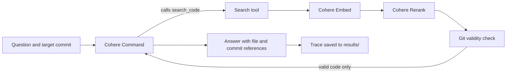

# Cohere Workshops

Dunia Hub's open source workshop series and research project on version-aware code retrieval, supported by Cohere Labs.

**Research project:** *Right Code, Wrong Version: Evaluating Temporal Robustness in Repository Level Code Retrieval*

**The question:** when an AI system searches a code repository, can it tell current code from old code that has since been changed or deleted?

## The workshop series

**From Fundamentals to Version Grounded AI.** Each workshop adds one stage to the same pipeline.

| Workshop | Topic | What it adds | Command |
| --- | --- | --- | --- |
| 1 | Cohere Fundamentals: Models, Prompts, Embeddings and Grounding | Introduction | |
| 2 | Cohere Embed: Searching Code Across Repository Versions | Semantic search across two Git versions | `cohere-versions` |
| 3 | Cohere Rerank: Choosing Current Code Over Stale Context | Reranking plus a Git validity check | `cohere-rerank` |
| 4 | Cohere Command: Building a Version Aware Code Agent | A read-only agent that answers from validated code | `cohere-agent` |

## What we found so far

These are exploratory runs on a small practice project and on this repository. They are not final research results.

- **Embed alone:** old code often ranked first, by gaps under 0.01.
- **Rerank:** improved the order, but old and new code still scored almost the same. Adding commit details to the text Rerank reads made the ranking worse.
- **Git check:** a simple rule against Git history removed invalid code every time.
- **Agent:** across four live questions, every answer matched its target commit, with no stale references, even though search put wrong-version code first in 5 of 12 searches.

The lesson: **the model ranks and answers, Git decides what is valid.**

## Installation

You need Git, Python 3.11 or newer and a Cohere API key for live runs.

macOS or Linux:

```bash
git clone https://github.com/dunia-hub/cohere-workshops.git
cd cohere-workshops
python3 -m venv .venv
source .venv/bin/activate
pip install -e ".[dev]"
cp .env.example .env
```

Windows PowerShell:

```powershell
git clone https://github.com/dunia-hub/cohere-workshops.git
cd cohere-workshops
python -m venv .venv
.\.venv\Scripts\Activate.ps1
pip install -e ".[dev]"
Copy-Item .env.example .env
```

Add your key to `.env`:

```env
COHERE_API_KEY=your_private_key
```

Never commit `.env`.

## Check your setup

```bash
ruff check src tests
pytest -q
```

Tests use fake Cohere clients, so they are free and work offline.

## Quick start

Create a small practice repository with an old version (`v1`) and a current version (`v2`):

```bash
cohere-demo-repo
```

Then run each stage:

```bash
# Workshop 2: search both versions with Cohere Embed
cohere-versions demo_repo --old v1 --new v2

# Workshop 3: rerank with Cohere Rerank, check against Git, filter old code
cohere-rerank demo_repo --old v1 --new v2 --format both

# Workshop 4: ask the agent a question at a target commit
cohere-agent demo_repo --old v1 --new v2 --question "How is the transfer fee calculated?"
cohere-agent demo_repo --old v1 --new v2 --target v1 --question "How is the transfer fee calculated?"
```

No API key yet? Add `--offline` to any of these. Practice mode counts words instead of calling Cohere, so it checks the plumbing but its results are not real.

Every command also works on a real repository with full Git history. For example, this repository before and after a real bug fix:

```bash
cohere-agent . --old d6cb3c2 --new 125198f --question "How are the float vectors read from the Cohere embed response?"
```

Runs are saved as JSON Lines in `results/`. Records store paths, commit hashes, chunk IDs and scores, never source code, vectors or API keys.

## All commands

| Command | What it does |
| --- | --- |
| `cohere-demo-repo` | Creates the practice repository with tags `v1` and `v2` |
| `cohere-versions` | Searches two versions with Cohere Embed and reports which version ranks first |
| `cohere-rerank` | Reranks candidates with Cohere Rerank, checks them against Git and filters old code |
| `cohere-agent` | Read-only agent: Cohere Command calls a search tool, Git validates evidence, Command answers |
| `cohere-workshops` | Builds a JSON map of a repository: files, symbols, imports, exclusions |
| `cohere-search` | Change-impact search and grounded prediction for a proposed change |
| `cohere-case` | Builds an evaluation case from a Git commit range |
| `cohere-dataset` | Validates an evaluation dataset manifest against Git |

Run any command with `--help` for its options.

## How it works



Deterministic code handles file discovery, Git history, version labels, validity, ground truth and metrics. Cohere models handle search, ranking, tool planning and writing. Models are never treated as the source of truth about the repository.

## Safety

Before any content is sent to Cohere, the pipeline applies Git ignore rules, sensitive filename checks, a 1 MB file size limit and secret detection. Every exclusion is recorded. The agent is read only: it never writes to, commits to or deletes from the repository it analyses.

## Research configurations

1. BM25 keyword retrieval
2. Cohere Embed retrieval
3. Cohere Embed with Cohere Rerank
4. Structural and semantic retrieval
5. Ungrounded Cohere Command baseline
6. Evidence-grounded Cohere Command prediction with abstention
7. Version-aware retrieval, reranking and agent with Git validation

Development cases stay separate from the final evaluation dataset.

## Documentation

### Research

- [Research protocol](docs/research/protocol.md)
- [Evaluation plan](docs/research/evaluation-plan.md)
- [Data and ethics](docs/research/data-and-ethics.md)
- [Experiment log](docs/research/experiment-log.md)

### Engineering

- [System architecture](docs/engineering/architecture.md)
- [Engineering decisions](docs/engineering/decisions.md)
- [Reproducibility guide](docs/engineering/reproducibility.md)

### Experiments

- [Exploratory records](experiments/exploratory)

## Current limitations

- Structural parsing supports Python only.
- Embeddings are not cached between runs.
- No final evaluation dataset has been built yet. The `cohere-case` and `cohere-dataset` commands are ready for it.
- The aggregate benchmark runner is not implemented.
- Dependency locking and continuous integration are not configured.
- All experiment records so far are exploratory, not final results.

## Contributing

We welcome contributions. Read [CONTRIBUTING.md](CONTRIBUTING.md), then pick an issue labelled `good first issue`.

## License

MIT. See [LICENSE](LICENSE).
