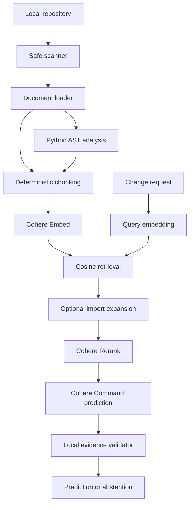

# System Architecture

## Status

Implemented and planned architecture for the evidence-grounded change-impact research prototype.

Last updated: 13 October 2026

## Design principle

Deterministic repository evidence is created and validated before a model reasons about a proposed change. Models are not treated as sources of truth for file existence, symbols, imports, exclusions or evaluation ground truth.

## Implemented pipeline



The same repository corpus also supports a deterministic BM25 keyword baseline.

## Safety and ingestion

### Repository scanner

`src/cohere_workshops/scanner.py`

The scanner:

- discovers supported text files in deterministic order;
- applies directory exclusions and Git ignore rules;
- rejects sensitive filenames;
- excludes files larger than 1,000,000 bytes;
- records every exclusion and its reason.

### Secret detection

`src/cohere_workshops/safety.py`

High-confidence patterns for private keys and selected provider credentials are detected before content enters the model pipeline. Suspected files are excluded and recorded. Test fixtures construct fake patterns at runtime so the repository itself is not incorrectly excluded.

### Document loading

`src/cohere_workshops/documents.py`

Accepted files are decoded as UTF-8, assigned repository-relative paths and languages, and hashed with SHA-256. Invalid UTF-8 is recorded as a processing error rather than terminating the complete scan.

## Deterministic repository evidence

### Python structure

`src/cohere_workshops/structure.py`

Python's AST provides:

- classes, functions and methods;
- qualified symbol names;
- start and end lines;
- imports.

Malformed Python is recorded as a processing error. Non-Python files remain available as text but do not receive invented structural metadata.

### Repository map

`src/cohere_workshops/mapper.py`

The map combines file metadata, hashes, symbols, imports, exclusions and processing errors. The `cohere-workshops` command serializes this evidence as JSON.

### Traceable chunks

`src/cohere_workshops/chunks.py` and `src/cohere_workshops/corpus.py`

The corpus contains deterministic file-level and symbol-level chunks. Every chunk retains:

- source path and language;
- kind and optional symbol;
- start and end lines;
- source and chunk hashes;
- stable chunk identifier;
- part index and count when content is split.

Chunks are capped at 12,000 characters while preserving full source coverage, including exceptionally long lines.

## Retrieval configurations

### BM25 baseline

`src/cohere_workshops/keyword.py`

A local deterministic BM25 implementation provides the lexical baseline without using Cohere credits.

### Cohere Embed retrieval

`src/cohere_workshops/embeddings.py` and `src/cohere_workshops/retrieval.py`

Repository chunks use `embed-v4.0` with the `search_document` input type. Change requests use `search_query`. Local cosine similarity ranks the initial candidates.

### Structural expansion

`src/cohere_workshops/relationships.py` and `src/cohere_workshops/structural_retrieval.py`

The optional structural configuration resolves local Python import relationships and adds bounded one-hop related files to the candidate set. Every expansion remains tied to deterministic repository evidence.

### Cohere Rerank

`src/cohere_workshops/reranking.py`

`rerank-v4.0-pro` reranks only the supplied candidates against the original change request. It cannot introduce content outside that set.

### Semantic orchestration

`src/cohere_workshops/semantic.py`

This layer coordinates corpus construction, embedding, retrieval, optional structural expansion and reranking.

## Evidence-grounded prediction

`src/cohere_workshops/prediction.py`

`command-a-plus-05-2026` receives the change request and reranked evidence. JSON Schema constrains the response to supported paths, symbols, chunk identifiers and test paths.

The local validator then checks:

- predicted files exist in retrieved evidence;
- symbols are supported by cited evidence;
- evidence identifiers are valid;
- test paths are supported;
- confidence values are within range;
- duplicate file predictions are normalized;
- required fields are present.

Unsupported model output is rejected. When no usable repository evidence is available, the system returns an explicit abstention with a reason.

## Command-line interfaces

### Repository mapping

```bash
cohere-workshops /path/to/repository
```

### Semantic retrieval and prediction

```bash
cohere-search /path/to/repository "change request"
cohere-search /path/to/repository "change request" --structural
cohere-search /path/to/repository "change request" --structural --predict
```

The search command returns JSON containing configuration, exclusions, errors, ranked evidence and, when requested, a validated prediction. It does not expose API keys, embedding vectors or complete source content.

## Evaluation boundary

`src/cohere_workshops/evaluation.py`

Metrics are calculated locally from recorded predictions and pull-request ground truth. Implemented file-level metrics include:

- Recall@K;
- Precision@K;
- reciprocal rank;
- average precision.

Ground truth must come from merged pull-request diffs against pre-change repository snapshots. Models do not generate ground truth.

## Deterministic and model-assisted boundaries

| Deterministic responsibilities | Model-assisted responsibilities |
| --- | --- |
| File discovery and exclusions | Semantic embeddings |
| Git ignore evaluation | Candidate reranking |
| Secret-pattern checks | Structured change-impact reasoning |
| UTF-8 loading and hashing | Natural-language reasons |
| AST parsing and import resolution | Confidence and unresolved questions |
| Chunk construction and identifiers | Evidence-linked predictions |
| Local output validation | Abstention recommendation |
| Diff-based ground truth and metrics | None of the ground-truth calculation |

## Security boundaries

- Cohere credentials remain in `.env`, which is excluded from Git and scanning.
- Repository content reaches Cohere only through an explicit live command.
- Automated tests use fake clients and do not spend API credits.
- Private repositories are outside the research scope.
- Sensitive paths, oversized files and suspected secrets are excluded before model calls.
- Output and logs must never contain API keys.

## Reproducibility

Every formal result must be traceable to the repository URL and pre-change commit, application commit, source hashes, chunk identifiers, model names, request configuration, experiment identifier, prediction and diff-derived ground truth.

Exploratory development runs are stored separately from the final evaluation dataset.

## Remaining architecture work

The prototype still requires:

- a reproducible pull-request dataset builder and manifest;
- an aggregate benchmark runner for every configuration;
- embedding caching;
- exact dependency locking;
- continuous integration;
- final experiment artifact and API-usage recording.
